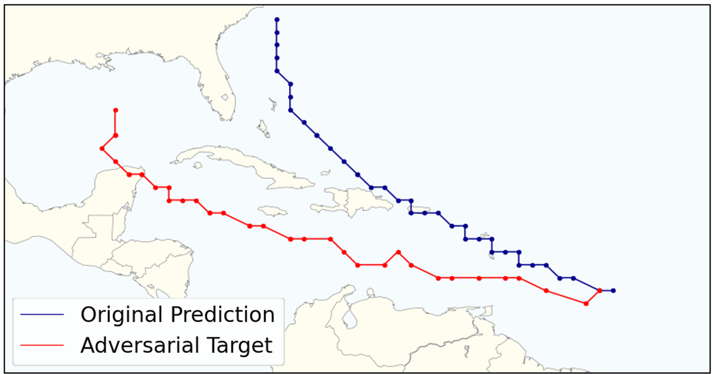
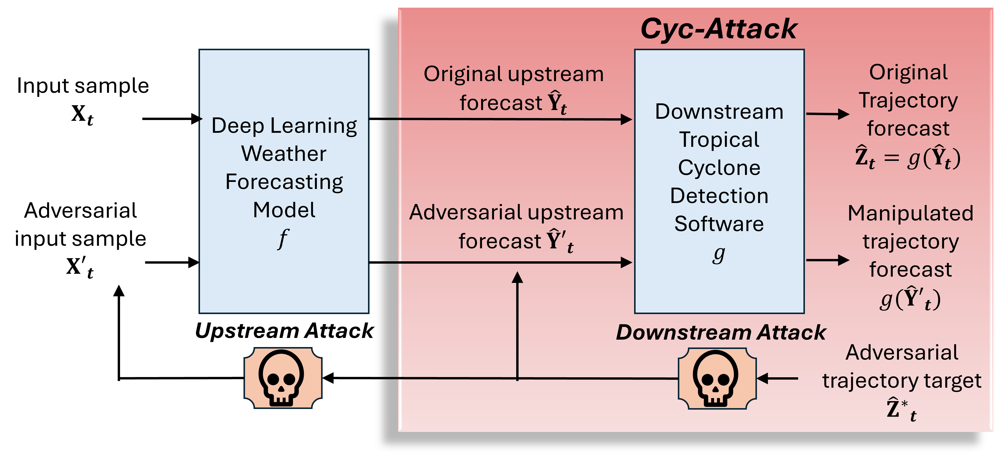
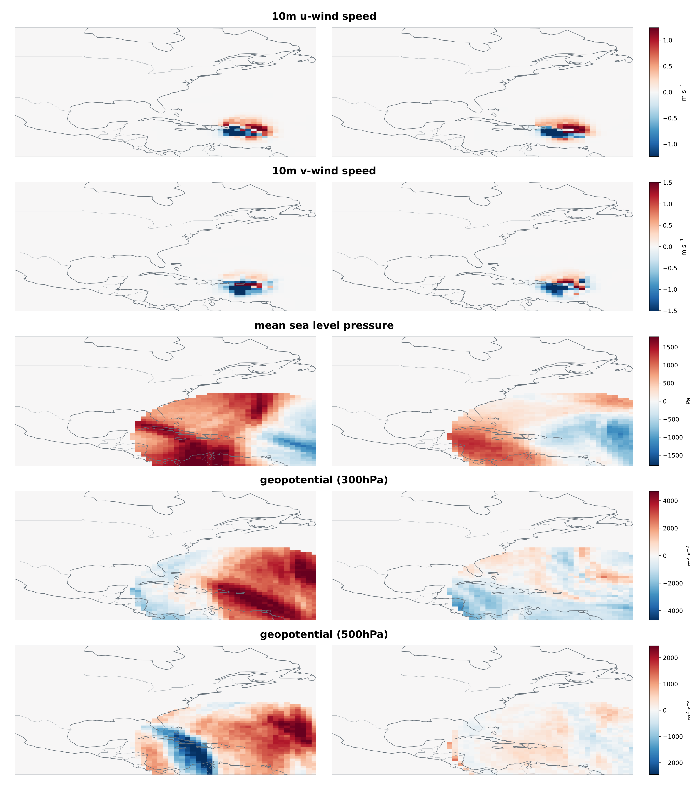
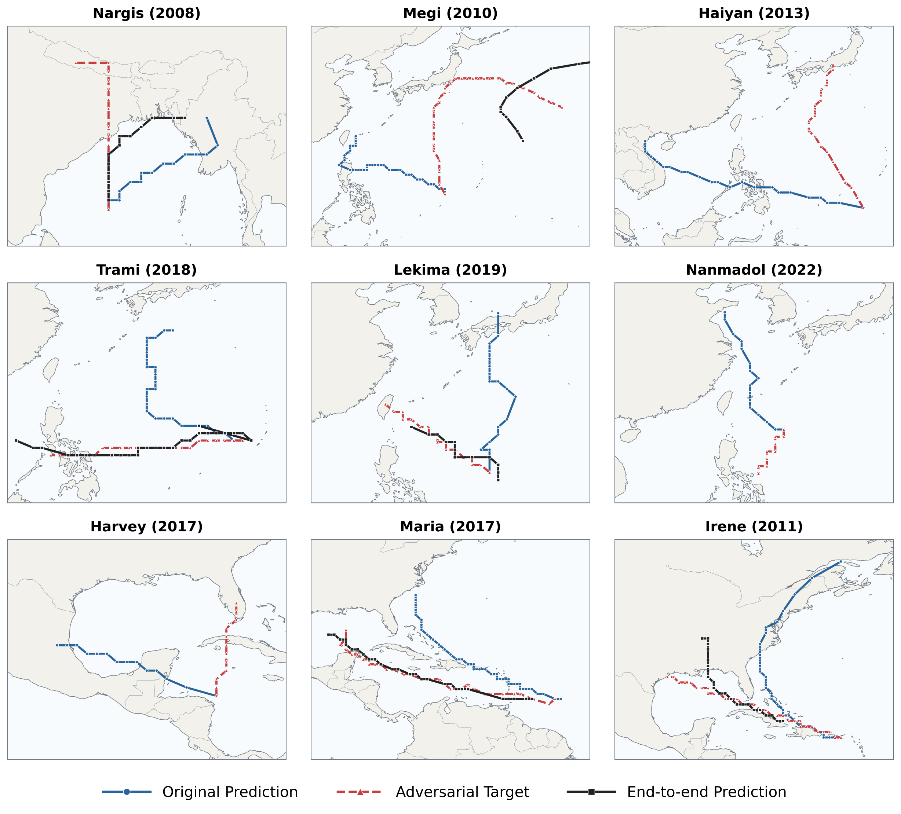
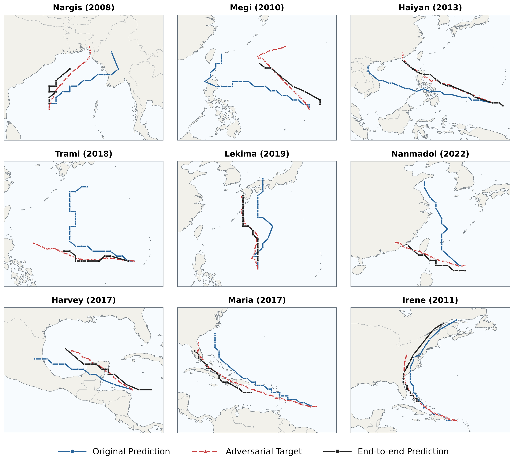

# Adversarial Attacks on Downstream Weather Forecasting Models: Application to Tropical Cyclone Trajectory Prediction

**Authors:** Yue Deng, Francisco Santos, Pang-Ning Tan, and Lifeng Luo

**Paper:** [arXiv:2510.10140](https://arxiv.org/abs/2510.10140)

## Overview

We propose adversarial attack methods that construct carefully manipulated weather inputs to deep learning weather forecasting (DLWF) models, with the goal of misleading downstream tropical cyclone (TC) trajectory predictions. Specifically, our attacks aim to suppress or misdirect the originally predicted TC trajectory while inducing a false alarm corresponding to a fabricated trajectory steered away from the original forecast.

Our implementation employs **GraphCast**, developed by Google DeepMind, as the DLWF model and **TempestExtremes** as the downstream TC detection and tracking system. Together, they form an end-to-end forecasting pipeline for evaluating how adversarial perturbations to upstream weather inputs propagate to downstream TC trajectory predictions.

## Case Study: Adversarial Manipulation of Tropical Cyclone Trajectories

We illustrate our attack methodology using Hurricane Maria as a representative case study.

### Attack Objective

Given a clean weather input sample, **GraphCast** generates the original weather forecasts, from which **TempestExtremes** detects and tracks tropical cyclones (TCs). The resulting trajectory, shown in **blue** in the figure below, is referred to as the **Original Prediction**.

Our objective is to introduce carefully crafted perturbations into the clean weather input to produce an **adversarial weather input**. When processed through the same GraphCast + TempestExtremes pipeline, the adversarial input should induce a downstream TC trajectory that deviates from the original prediction and follows a predefined trajectory, shown in **red** and referred to as the **Adversarial Target**.

### Proposed Cyc-Attack Framework

To achieve this objective, we propose **Cyc-Attack**, an adversarial attack framework designed to manipulate downstream TC trajectory predictions by perturbing upstream weather inputs. The overall architecture is illustrated below.

### Adversarial Perturbations and Attack Results

Using Cyc-Attack, we generate adversarial perturbations to the clean weather input, as illustrated below.

These perturbations are designed to steer the downstream TC trajectory detected by TempestExtremes toward the predefined **Adversarial Target**, while modifying only the upstream input to GraphCast.

The resulting end-to-end adversarial predictions are shown below. Cyc-Attack aims to minimize the deviation between the **Adversarial Prediction** and the predefined **Adversarial Target**.

In addition to the Hurricane Maria example, we evaluate Cyc-Attack on **nine additional tropical cyclone case studies** to assess its effectiveness across different forecasting scenarios.

### Attack Performance with Less Deviated Targets

We further investigate the effectiveness of Cyc-Attack when the adversarial target trajectories are closer to the original predictions.

Compared with **Target 1**, which introduces larger deviations from the original trajectories, **Target 2** specifies less deviated adversarial trajectories. Under these settings, Cyc-Attack achieves a higher attack success rate, demonstrating that the framework can more effectively steer downstream TC predictions toward targets requiring smaller trajectory deviations.

The corresponding end-to-end attack results are presented below.

